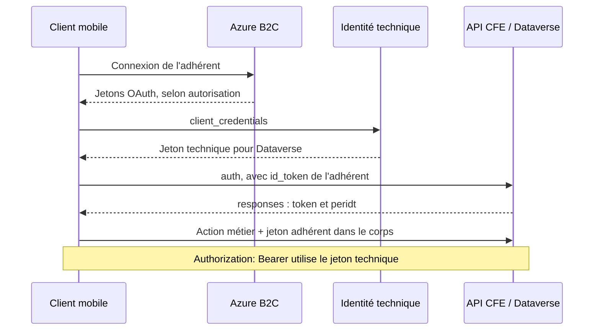

# Analyse de CFE & Moi pour Android

Analyse du **11 novembre 2026**, à partir des APK de l'application installée sur le téléphone
du titulaire. Package `fr.cfe.fdsl`, version **3.7.0**, code de version **307000**.
L'application utilise Flutter et un binaire Dart AOT ARM64 obfusqué.

**L'API mobile fonctionne pour l'authentification renouvelable et les lectures du compte.**
L'authentification métier, les bénéficiaires, remboursements, options et un décompte PDF ont été
vérifiés en ligne. Les lectures principales du MCP utilisent cette API. Le parcours d'écriture
est implémenté et testé avec un transport simulé ; aucun dépôt réel n'a encore été effectué.

## Authentification : ce que l'APK établit

La configuration de production contient :

| Paramètre | Valeur observée |
| --- | --- |
| Tenant B2C | `cfeb2cprod` |
| Politique | `B2C_1A_LOGIN_USERNAME` |
| Client public | `793871d1-9278-40a6-aa15-096bfa55c238` |
| URI de retour de l'application | `fr.cfe.fdsl://oauth/` |
| Scopes demandés | `openid offline_access` |
| Bibliothèque | `flutter_appauth`, avec AppAuth Android |
| Méthode | `authorizeAndExchangeCode` |
| Paramètre de connexion | `promptValues: ["login"]` |

Le manifeste déclare le récepteur de retour AppAuth pour le schéma `fr.cfe.fdsl`.
La découverte OIDC de production a également été consultée avec succès :

```text
https://cfeb2cprod.b2clogin.com/cfeb2cprod.onmicrosoft.com/B2C_1A_LOGIN_USERNAME/v2.0/.well-known/openid-configuration
```

La différence avec le parcours web capturé est réelle : le web demandait `openid` seul.
Le mobile demande aussi `offline_access` et écrit les clés locales `azureIdToken`,
`azureRefreshToken`, `azureTokenExpiry` et `azureAuthProvider`.

Les références au cache `azureRefreshToken` retrouvées dans le binaire correspondent à
l'enregistrement et à l'effacement de la valeur. Aucun chemin de lecture puis d'échange de ce
refresh token n'a été identifié dans les fonctions analysées. Cela ne permet pas de conclure sur
le comportement de toutes les versions de l'application ; un test direct a donc été effectué.

**Le test direct a réussi.** Après connexion du titulaire dans une nouvelle fenêtre Chrome :

1. Autorisation avec les paramètres natifs et PKCE S256.
2. Échange du code : réception d'un `id_token` et d'un `refresh_token`.
3. Vérification de la signature RS256 avec les clés publiques B2C, de l'émetteur, du client,
   de la validité temporelle et du nonce.
4. Échange `grant_type=refresh_token` : réponse HTTP **200**, nouvel ID token et refresh token,
   sans nouveau code e-mail. L'identité est restée identique.

La réponse n'a pas fourni d'`access_token` Dataverse. Les durées annoncées étaient
`id_token_expires_in=300` et `refresh_token_expires_in=1209600`, soit **5 minutes** et **14 jours**.
Ces durées ne prouvent pas une connexion garantie pendant 14 jours, ni un renouvellement illimité.
La révocation et les limites de renouvellement imposées par le serveur restent applicables.

Le MCP possède maintenant les outils `cfe_mobile_start_login`, `cfe_mobile_finish_login` et
`cfe_mobile_session_status`. Le dernier renouvelle automatiquement l'ID token lorsqu'il expire
dans les 30 secondes ; `refresh=true` force un échange. La session est enregistrée localement dans
`mobile-session.json`, avec remplacement du refresh token et verrou entre processus.

La documentation [Microsoft sur le flux d'autorisation B2C](https://learn.microsoft.com/en-us/azure/active-directory-b2c/authorization-code-flow)
décrit `offline_access` comme la demande d'un refresh token. Le test confirme que cette demande
est acceptée ici. Une première connexion reste nécessaire et le serveur peut en imposer une nouvelle.

## Deux couches d'authentification dans les appels mobiles



Les trois échanges d'authentification du diagramme ont été exécutés avec succès pour le compte
du titulaire. Aucune requête générique vers les entités Dataverse n'a été nécessaire.

Le client construit un jeton technique avec `grant_type=client_credentials` et le scope
`https://cfeprod.crm4.dynamics.com/.default`. Il le stocke comme `svcAcctToken` et l'ajoute à
l'en-tête `Authorization`. L'appel `new_api_applimob_auth` transmet séparément l'`id_token`
de l'adhérent ; son parseur attend `token` et `peridt` dans la chaîne JSON `responses`.

Le client conserve ensuite ce jeton CFE sous `CacheManagerKey.token`. Le code commun ajoute
un champ `token` aux corps des requêtes qui demandent l'authentification adhérent. Le numéro
`peridt` est également conservé. Les deux jetons ont des rôles différents ; remplacer le Bearer
technique par l'ID token B2C ne reproduirait pas le protocole observé.

Les paramètres secrets du client technique sont conservés uniquement dans la configuration
privée locale, hors dépôt. Le MCP ne distribue pas ces secrets. Les jetons techniques sont
renouvelés selon leur expiration annoncée. Faute de durée explicitement vérifiée pour le jeton
adhérent CFE, le client le renouvelle au plus tard avec l'ID token B2C auquel il est lié.
Une lecture peut être retentée une fois après un rejet d'authentification explicite ; les
écritures ne sont jamais répétées automatiquement après une erreur réseau.

## Actions retrouvées

Base de production :

```text
https://cfeprod.crm4.dynamics.com/api/data/v9.2/
```

Le constructeur commun configure des requêtes **POST JSON**. Les noms complets des actions
ont tous le préfixe `new_api_applimob_`. Les champs ci-dessous sont ceux construits par chaque
méthode, avant l'ajout conditionnel du champ d'authentification `token`.

| Suffixe de l'action | Champs observés | Fonction ARM64 |
| --- | --- | --- |
| `auth` | `id_token` | `0x38c9fc` |
| `checkVersion` | `body` : JSON sérialisé avec `appVersion`, `deviceType` | `0x313150` |
| `flux17` | `version` | `0x2f4d94` |
| `getParams` | Aucun champ propre dans le constructeur | `0x31521c` |
| `getActeDetails` | Aucun champ propre dans le constructeur | `0x3155d0` |
| `getCurrencies` | Aucun champ propre dans le constructeur | `0x3175dc` |
| `getCircumstances` | Aucun champ propre dans le constructeur | `0x3189dc` |
| `getRecipients` | `id`, converti en chaîne | `0x317a8c` |
| `getRemboursement` | `id`, converti en chaîne | `0x390c08` |
| `getDocRemboursement` | `id`, `idRemboursement` | `0x39ee8c` |
| `registerDevice` | `id`, `body` : JSON avec `deviceType`, `fcmToken`, `idDevice` | `0x38b6bc` |
| `activateDevice` | `id`, `deviceId`, `body` : `{"isActivated":"true"}` sérialisé | `0x38a458` |
| `checkCare` | `id`, `body` | `0x382d24` |
| `addDocument` | `type`, `file_name`, `file_content`, `ref_id` | `0x313984` |
| `deleteDocument` | `file_id` | `0x379c04` |
| `sendRequest` | `id`, `careId`, `body` | `0x393270` |

Les adresses sont des adresses virtuelles dans le `libapp.so` de cette version. Elles ne sont
pas stables entre versions. Les libellés d'action indiquent leur intention, mais ne prouvent
pas à eux seuls leurs effets serveur. En particulier, `checkCare` n'est pas traité comme une
lecture inoffensive tant que son comportement n'a pas été établi.

Le fichier [mobile-endpoints.json](mobile-endpoints.json) précise le niveau de vérification
de chaque action. `auth`, `getRecipients`, `getRemboursement`, `getDocRemboursement`, `getParams`,
`getActeDetails`, `getCurrencies` et `getCircumstances` sont vérifiés en ligne. Les actions de
dépôt sont reconstituées et testées hors ligne. Les actions d'appareil/version ne sont pas exposées.

## Structure d'une demande

La méthode de soumission construit un corps externe contenant `id`, `careId` et `body`.
La valeur de `body` est issue de la sérialisation JSON d'un objet comportant `incident` et
`soins`. `careId` reprend le `ref_id` commun obtenu lors du premier ajout de pièce. La fonction
`0x5c0e34` conserve ce résultat dans l'état partagé, relu par le dépôt à `0x5cf024`.

`addDocument` prend le type de pièce, le nom, le contenu en base64 et ce `ref_id` (vide au
premier fichier). Les types sont feuille `100000000`, ordonnance `100000001`, facture `100000002`,
autre `100000003`. La limite observée est de 3 145 728 octets, comparaison à `0x314fa8`.
Les extensions PDF, JPG, JPEG et PNG figurent dans la configuration de sélection des fichiers.

Le sérialiseur `incident` à `0x383474` écrit :

```text
new_peridt
benefIDT
new_typecontact
new_codepays
new_codedevise
new_circonstance
new_datededemandederemboursement
new_commentaire
```

Le sérialiseur d'un soin à `0x382f54` écrit notamment :

```text
new_verification, reasonCare, new_datedusoin, new_precisezlazone,
new_absencedatedescription, new_datedeprescription,
new_datededebutdetraitement, new_datedefindetraitement,
new_nombredeseancesdispensees, new_descriptiondutraitement,
new_descriptiondesfraisfactures, new_datedexecution, new_datededelivrance,
new_dureeprevisibleenmois, new_precisezlemodedetransport,
new_datedu1ertransport, new_codedevise, new_montant,
new_montantprisenchargeparorganismelocal,
new_datedebutdesejour, new_datefindesejour
```

Ces noms ont été relevés tels quels, y compris `new_absencedatedescription`. Les dates sont
formatées `yyyy-MM-dd` par `0x380c34`. `new_typecontact` vaut `adh` pour le titulaire et `benef`
pour un bénéficiaire lié (`0x384010`). `new_verification` contient le code feuille du soin,
sans espaces autour (`0x383990`). Le champ d'absence de prescription est booléen.

`new_datededemandederemboursement` reçoit la date conditionnelle de circonstance, pas une date
du jour ajoutée par le MCP. Les champs non utilisés restent nuls. Les correspondances sont
implémentées dans `src/cfe_mcp/care.py` ; les contraintes supplémentaires restent contrôlées
par la CFE, à vérifier avec un vrai dossier.

L'asset `acte_details_code_data.json` contient **88 définitions de formulaires de soins**.
Il décrit les champs, libellés, types de saisie, obligations et certaines conditions d'affichage.
Par exemple, `a_1_1_1` exige `dateCare`, `amount` et `codeDevise`, et prévoit `localAmount` en option
pour les soins à l'étranger. Le catalogue actuel comporte 85 feuilles, toutes couvertes par
ces schémas. Les définitions locales B_1_1, J_2 et P_1 ne sont pas des feuilles actives et ne
sont donc pas proposées pour préparer une demande.

Les réponses de lecture utilisent `responses` et `error`, souvent des chaînes JSON internes.
Les callbacks de dépôt examinent un canal `error` qui peut être une liste. Le MCP vérifie
explicitement ce canal, sans reprendre la faute `errorTypex` observée dans certains callbacks.
Une réponse ambiguë ou un accusé d'upload sans `ref_id`/`file_id` bloque la suite.

## Preuves et reproductibilité

Les fichiers ont été copiés par ADB depuis les chemins APK retournés par
`pm path fr.cfe.fdsl`. Aucune extraction des données privées de l'application, modification
du téléphone ou interception TLS n'a été nécessaire pour ces résultats.

| Fichier | SHA-256 |
| --- | --- |
| `base.apk` | `02c6fe1dd98302e4ee420b64b72f2a144a3d54fa22364a9581cffa3d7052d661` |
| `split_config.arm64_v8a.apk` | `b853b3dbc8dc352d20c5c21097f68f8c497d6b7ffdd6d8b534b4a0e329fa24c3` |

Le manifeste et les plugins Android ont été examinés avec JADX. Les constantes Dart ont été
extraites avec [Blutter](https://github.com/worawit/blutter), puis les instructions ARM64 ont
été rapprochées de ces constantes avec Capstone. Les fonctions Flutter obfusquées n'ont pas
fourni un code source Dart directement réutilisable.

Les APK, binaires, désassemblages et résultats OAuth bruts restent dans le dossier privé
`~/.local/share/cfe-mcp/research/android/`, hors du dépôt. Ce document et le catalogue ne contiennent
ni données médicales du compte, ni jetons, ni secrets du client technique.

## Vérification restante

Le parcours complet, les limites locales, les empreintes de documents, le journal avant envoi,
les interruptions et les doubles soumissions sont couverts par des tests simulés. Le serveur
MCP stdio a aussi été interrogé avec succès pour les lectures du compte.

Il reste à contrôler puis déposer **une demande réelle fournie par le titulaire**, observer
les accusés effectifs et rapprocher le résultat du portail. Le dépôt réel n'est pas déclaré
validé avant cette étape. Voir [le guide des demandes](CLAIMS.md) pour les outils et états.
